**[English](./README.md)** | [中文](./README_zh.md) | [日本語](./README_ja.md)

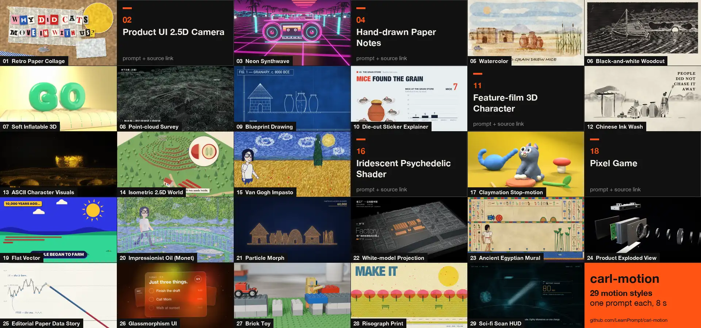

# carl-motion

**29 motion-graphics styles, one copy-paste prompt each.** Paper collage, synthwave, ink wash, woodcut, point cloud, claymation, risograph, glass UI and more. Every style comes with an 8-second example, the prompt, the mistakes that usually break it, and for 20 of them the full source code that rendered the clip.

Install the Skill, then tell your agent *make my topic in the risograph style*:

```bash
npx skills add LearnPrompt/carl-motion
```

Claude Code also works as a plugin: `/plugin marketplace add LearnPrompt/carl-motion` then `/plugin install carl-motion@carl-motion`.

## Contents

- [Start here](#start-here)
- [The 29 styles](#the-29-styles)
- [Skill](#skill)
- [Templates and source](#templates-and-source)
- [How the examples were made](#how-the-examples-were-made)
- [Upstream skills and references](#upstream-skills-and-references)
- [Media and licenses](#media-and-licenses)
- [Acknowledgements](#acknowledgements)
- [Author](#author)

## Start here

Nothing to install for the first try. Pick a look in the gallery below and open its page. Copy the prompt block and replace *your topic* with your own subject. Paste it into Claude, ChatGPT or any model that writes code, and ask for a 1920×1080, 30 fps, 8-second MP4. If the result looks off, read that page's **Where it usually breaks** section and run it again.

## The 29 styles

The order follows the video we cut from them: neighbouring styles sit on roughly complementary colors, so each cut reads as a clear change. 24 of the 29 play here. The other 5 only have third-party examples we can't redistribute, so their pages link to the source instead.

<table>
<tr>
<td width="33%" valign="top" align="center"><a href="./docs/styles/retro-paper-collage.md">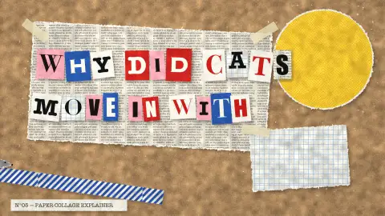</a><br><b>01 · Retro Paper Collage</b><br><sub>复古纸张拼贴</sub><br><sub>source included · HTML</sub></td>
<td width="33%" valign="top" align="center"><a href="./docs/styles/product-ui-2-5d.md">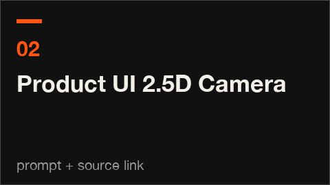</a><br><b>02 · Product UI 2.5D Camera</b><br><sub>产品界面2.5D运镜</sub><br><sub>Remotion</sub></td>
<td width="33%" valign="top" align="center"><a href="./docs/styles/neon-synthwave.md">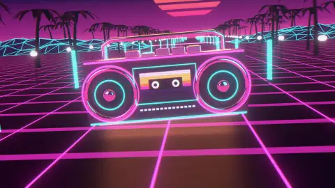</a><br><b>03 · Neon Synthwave</b><br><sub>霓虹复古Synthwave</sub><br><sub>source included · any stack</sub></td>
</tr>
<tr>
<td width="33%" valign="top" align="center"><a href="./docs/styles/hand-drawn-notes.md"></a><br><b>04 · Hand-drawn Paper Notes</b><br><sub>纸面手绘笔记</sub><br><sub>HTML</sub></td>
<td width="33%" valign="top" align="center"><a href="./docs/styles/watercolor.md">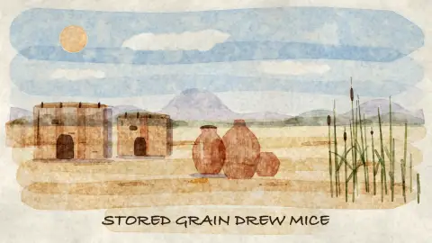</a><br><b>05 · Watercolor</b><br><sub>水彩手绘</sub><br><sub>source included · Canvas</sub></td>
<td width="33%" valign="top" align="center"><a href="./docs/styles/woodcut.md"></a><br><b>06 · Black-and-white Woodcut</b><br><sub>黑白木刻版画</sub><br><sub>source included · any stack</sub></td>
</tr>
<tr>
<td width="33%" valign="top" align="center"><a href="./docs/styles/soft-inflatable-3d.md"></a><br><b>07 · Soft Inflatable 3D</b><br><sub>软体充气3D</sub><br><sub>source included · Blender</sub></td>
<td width="33%" valign="top" align="center"><a href="./docs/styles/point-cloud-survey.md">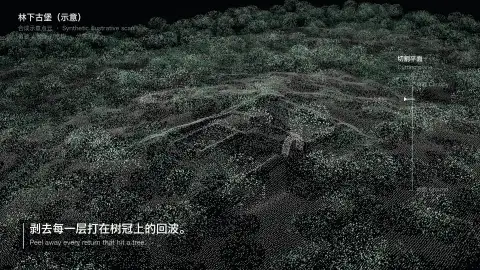</a><br><b>08 · Point-cloud Survey</b><br><sub>点云测绘／剥层</sub><br><sub>source included · Three.js</sub></td>
<td width="33%" valign="top" align="center"><a href="./docs/styles/blueprint.md">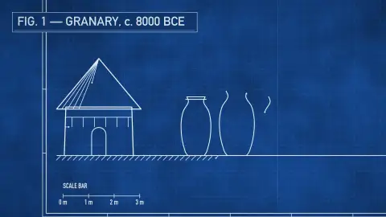</a><br><b>09 · Blueprint Drawing</b><br><sub>蓝图工程制图</sub><br><sub>source included · Canvas</sub></td>
</tr>
<tr>
<td width="33%" valign="top" align="center"><a href="./docs/styles/sticker-explainer.md">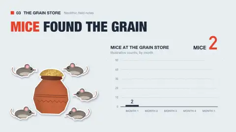</a><br><b>10 · Die-cut Sticker Explainer</b><br><sub>贴纸科普</sub><br><sub>source included · HTML</sub></td>
<td width="33%" valign="top" align="center"><a href="./docs/styles/feature-3d-character.md"></a><br><b>11 · Feature-film 3D Character</b><br><sub>动画电影式3D角色</sub><br><sub>the best technology you can think of</sub></td>
<td width="33%" valign="top" align="center"><a href="./docs/styles/chinese-ink-wash.md">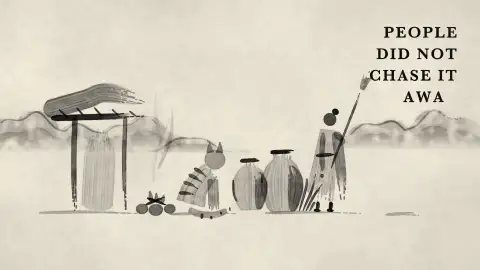</a><br><b>12 · Chinese Ink Wash</b><br><sub>中国水墨</sub><br><sub>source included · code</sub></td>
</tr>
<tr>
<td width="33%" valign="top" align="center"><a href="./docs/styles/ascii-crt.md"></a><br><b>13 · ASCII Character Visuals</b><br><sub>ASCII字符视觉</sub><br><sub>any stack</sub></td>
<td width="33%" valign="top" align="center"><a href="./docs/styles/isometric-world.md">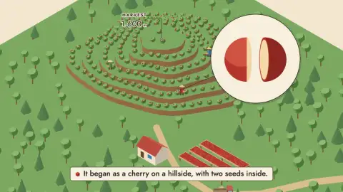</a><br><b>14 · Isometric 2.5D World</b><br><sub>等轴2.5D世界</sub><br><sub>any stack</sub></td>
<td width="33%" valign="top" align="center"><a href="./docs/styles/van-gogh-impasto.md">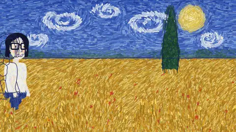</a><br><b>15 · Van Gogh Impasto</b><br><sub>梵高厚涂油画</sub><br><sub>source included · Canvas 2D</sub></td>
</tr>
<tr>
<td width="33%" valign="top" align="center"><a href="./docs/styles/psychedelic-shader.md">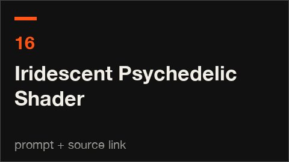</a><br><b>16 · Iridescent Psychedelic Shader</b><br><sub>虹彩迷幻Shader</sub><br><sub>a shader</sub></td>
<td width="33%" valign="top" align="center"><a href="./docs/styles/claymation.md"></a><br><b>17 · Claymation Stop-motion</b><br><sub>黏土定格</sub><br><sub>source included · Blender</sub></td>
<td width="33%" valign="top" align="center"><a href="./docs/styles/pixel-game.md">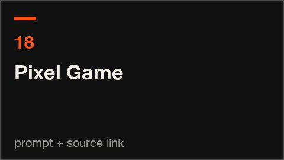</a><br><b>18 · Pixel Game</b><br><sub>像素游戏</sub><br><sub>Canvas</sub></td>
</tr>
<tr>
<td width="33%" valign="top" align="center"><a href="./docs/styles/flat-vector.md">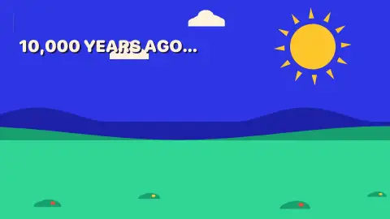</a><br><b>19 · Flat Vector</b><br><sub>扁平矢量</sub><br><sub>source included · SVG plus GSAP</sub></td>
<td width="33%" valign="top" align="center"><a href="./docs/styles/monet-impressionist.md">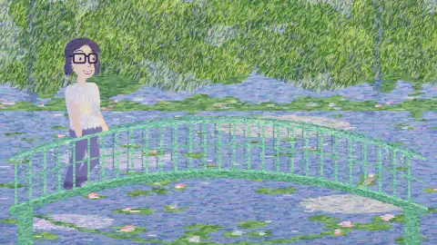</a><br><b>20 · Impressionist Oil (Monet)</b><br><sub>印象派油画／莫奈</sub><br><sub>source included · Canvas 2D</sub></td>
<td width="33%" valign="top" align="center"><a href="./docs/styles/particle-morph.md">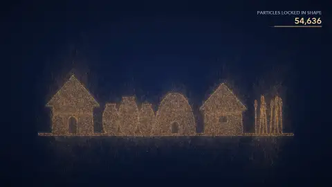</a><br><b>21 · Particle Morph</b><br><sub>粒子聚散造型</sub><br><sub>source included · any stack</sub></td>
</tr>
<tr>
<td width="33%" valign="top" align="center"><a href="./docs/styles/white-model-projection.md">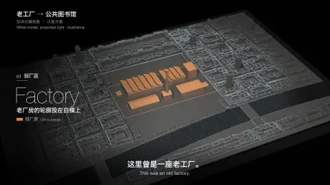</a><br><b>22 · White-model Projection</b><br><sub>实体白模投影</sub><br><sub>source included · Three.js</sub></td>
<td width="33%" valign="top" align="center"><a href="./docs/styles/egyptian-mural.md"></a><br><b>23 · Ancient Egyptian Mural</b><br><sub>古埃及壁画</sub><br><sub>source included · Canvas 2D</sub></td>
<td width="33%" valign="top" align="center"><a href="./docs/styles/exploded-view.md">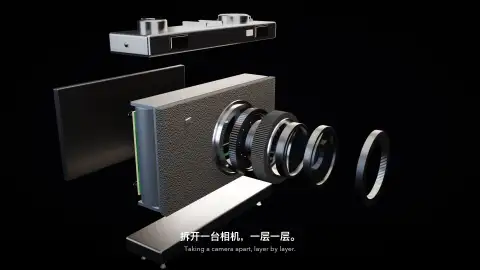</a><br><b>24 · Product Exploded View</b><br><sub>产品爆炸拆解</sub><br><sub>source included · Blender</sub></td>
</tr>
<tr>
<td width="33%" valign="top" align="center"><a href="./docs/styles/editorial-dataviz.md">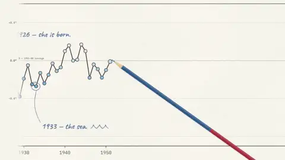</a><br><b>25 · Editorial Paper Data Story</b><br><sub>纸面编辑式数据叙事</sub><br><sub>Canvas</sub></td>
<td width="33%" valign="top" align="center"><a href="./docs/styles/glassmorphism-ui.md"></a><br><b>26 · Glassmorphism UI</b><br><sub>玻璃拟态UI</sub><br><sub>source included · HTML</sub></td>
<td width="33%" valign="top" align="center"><a href="./docs/styles/brick-toy.md"></a><br><b>27 · Brick Toy</b><br><sub>积木玩具</sub><br><sub>source included · Blender</sub></td>
</tr>
<tr>
<td width="33%" valign="top" align="center"><a href="./docs/styles/risograph.md">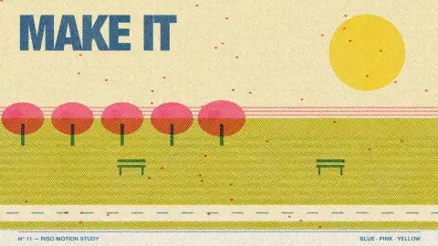</a><br><b>28 · Risograph Print</b><br><sub>Risograph孔版套印</sub><br><sub>source included · code</sub></td>
<td width="33%" valign="top" align="center"><a href="./docs/styles/scifi-hud.md"></a><br><b>29 · Sci-fi Scan HUD</b><br><sub>科幻扫描HUD</sub><br><sub>Three.js wireframes</sub></td>
</tr>
</table>

## Skill

`carl-motion` turns this library into something your coding agent can use. Ask for a style by name or by look (*flat, warm, hand-made*). The agent picks the closest entry, fills the prompt with your topic, checks it against the known failure points, and when the style ships source code here, it starts from that engine instead of a blank file. Every card says how far the style is proven (implemented, upstream only, or research), and the finished clip has to pass the same delivery gate.

| | Prompt pages | Skill |
|---|---|---|
| For | Anyone, no install | Claude Code, Codex and other coding agents |
| How | Copy, swap your topic, paste | `npx skills add LearnPrompt/carl-motion`, then just ask |
| You get | One prompt | A prompt, a render plan and a check against known failures |

## Templates and source

**Scene engines.** 20 styles ship the code that rendered their B clip, all at 1920×1080, 30 fps, 240 frames. Every engine has the same entry, `./render.sh <work_dir>`, writes 240 PNG frames, and hands them to `scripts/deliver.py`, which encodes the clip and returns a red, yellow or green verdict. `scripts/doctor.py <engine>` checks the machine first. Contract: [scene-contract.md](skills/carl-motion/references/scene-contract.md).

| Folder | Style | Stack |
|---|---|---|
| [`retro-paper-collage`](skills/carl-motion/scenes/retro-paper-collage) | Retro Paper Collage | Python (NumPy + OpenCV + Pillow) |
| [`neon-synthwave`](skills/carl-motion/scenes/neon-synthwave) | Neon Synthwave | Blender + Python |
| [`watercolor`](skills/carl-motion/scenes/watercolor) | Watercolor | Python (NumPy + OpenCV + Pillow) |
| [`woodcut`](skills/carl-motion/scenes/woodcut) | Black-and-white Woodcut | Python (NumPy + OpenCV + Pillow) |
| [`soft-inflatable-3d`](skills/carl-motion/scenes/soft-inflatable-3d) | Soft Inflatable 3D | Blender + Python |
| [`point-cloud-survey`](skills/carl-motion/scenes/point-cloud-survey) | Point-cloud Survey | Blender + Python |
| [`blueprint`](skills/carl-motion/scenes/blueprint) | Blueprint Drawing | Python (NumPy + OpenCV + Pillow) |
| [`sticker-explainer`](skills/carl-motion/scenes/sticker-explainer) | Die-cut Sticker Explainer | Python (NumPy + OpenCV + Pillow) |
| [`chinese-ink-wash`](skills/carl-motion/scenes/chinese-ink-wash) | Chinese Ink Wash | Python (NumPy + OpenCV + Pillow) |
| [`huashu-portraits`](skills/carl-motion/scenes/huashu-portraits) | Van Gogh Impasto / Impressionist Oil (Monet) / Ancient Egyptian Mural | Node + Canvas / headless Chrome |
| [`claymation`](skills/carl-motion/scenes/claymation) | Claymation Stop-motion | Blender + Python |
| [`flat-vector`](skills/carl-motion/scenes/flat-vector) | Flat Vector | Python (NumPy + OpenCV + Pillow) |
| [`particle-morph`](skills/carl-motion/scenes/particle-morph) | Particle Morph | Python (NumPy + OpenCV + Pillow) |
| [`white-model-projection`](skills/carl-motion/scenes/white-model-projection) | White-model Projection | Blender + Python |
| [`exploded-view`](skills/carl-motion/scenes/exploded-view) | Product Exploded View | Blender + Python |
| [`glassmorphism-ui`](skills/carl-motion/scenes/glassmorphism-ui) | Glassmorphism UI | Node + Canvas / headless Chrome |
| [`brick-toy`](skills/carl-motion/scenes/brick-toy) | Brick Toy | Blender + Python |
| [`risograph`](skills/carl-motion/scenes/risograph) | Risograph Print | Python (NumPy + OpenCV + Pillow) |

**9:16 explainer layout.** [`skills/carl-motion/pipeline/script_layout.py`](skills/carl-motion/pipeline/script_layout.py) stacks two clips of the same style (A over B), adds a fixed title bar, and puts the result first: from frame 0 each style shows its name and a prompt card already half written, the rest streams in like model output, and a warning strip lands at 5.4 s. A presenter box on the right is a placeholder for a talking-head shot.

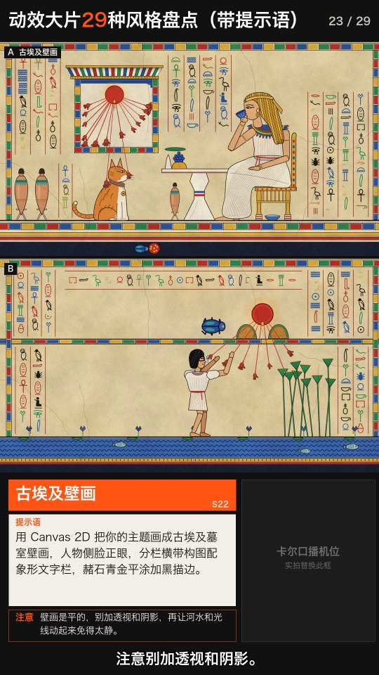

**Pipeline.** The rest of [`skills/carl-motion/pipeline`](skills/carl-motion/pipeline) is the tooling behind the video: `encode.sh` (one H.264 spec for every clip), `qa.py` (format, black-frame and jump-cut checks), `color_order_v4.py` (orders styles so neighbours sit on complementary colors), `color_stitch_verify.py` (re-measures every cut on the finished video) and `opener_salience.py` (scores candidate openers in CIELAB). See its [README](skills/carl-motion/pipeline/README.md).

## How the examples were made

Every style is a pair of 8-second clips. A is an upstream reference; B is a second example in the same style, so viewers can see the look carry over to a different subject. 20 of the B clips were written and rendered from scratch for this repo by Claude Opus 5.5, from a style prompt plus the A clip as reference, and seven of them retell one short story, how cats moved in with the first farmers, each in its own style. Every clip passed the same checks: 1920×1080, 30 fps, exactly 240 frames, full decode, no black frames, and every flagged jump frame inspected by eye.

## Upstream skills and references

These are the style skills and galleries this library was built on. Their prompts are linked from each style page.

| Upstream | What we took from it | License |
|---|---|---|
| [lemomo-ai/lemo-opuscar](https://github.com/lemomo-ai/lemo-opuscar) | Style recipes and demo films for 13 of the 29 styles (blueprint, watercolor, ink wash, woodcut, point cloud, white model, teardown, brick toy, risograph, ASCII, isometric, dataviz, HUD) | prompts and code MIT, demo films CC BY 4.0 |
| [Vincentwei1021/mg-styles-15](https://github.com/Vincentwei1021/mg-styles-15) | Style prompts for collage, flat vector, sticker explainer, glass UI, synthwave, soft 3D, isometric, HUD | MIT (prompts and code) |
| [alchaincyf/huashu-art-motion](https://github.com/alchaincyf/huashu-art-motion) | Painter engines for Egyptian mural, Van Gogh and Monet; our A clips are re-rendered from its source | MIT |
| [Vincentwei1021/video-shotcraft](https://github.com/Vincentwei1021/video-shotcraft) | Product-UI promo and risograph misregistration references | see upstream |
| [prompt-motion.com](https://prompt-motion.com) | Public references for pixel game, claymation, 3D character, hand-drawn notes, shader, particles, ASCII | link only |
| [yasue.org: Pushing Opus 5.5 video generation limits](https://en.yasue.org/article/pushing-opus-5-5-video-generation-limits) | The cats-move-into-the-village story our seven English explainer clips retell | link only |

## Media and licenses

Code, prompts and our own renders (`assets/previews`, `assets/posters` for styles marked *source included*, everything under `skills/`) are MIT. Preview clips for four styles are LemoLab demo films under CC BY 4.0 and are credited on their pages. Clips from prompt-motion.com, X, yasue.org and video-shotcraft are not copied here: their pages link out. The 9:16 sample frame uses a huashu (MIT) A clip and our B clip.

## Acknowledgements

- [lemomo-ai/lemo-opuscar](https://github.com/lemomo-ai/lemo-opuscar), [Vincentwei1021/mg-styles-15](https://github.com/Vincentwei1021/mg-styles-15), [alchaincyf/huashu-art-motion](https://github.com/alchaincyf/huashu-art-motion) for the open style recipes.
- [prompt-motion.com](https://prompt-motion.com) and [yasue.org](https://en.yasue.org/article/pushing-opus-5-5-video-generation-limits) for public references.
- [LearnPrompt/awesome-seedance](https://github.com/LearnPrompt/awesome-seedance) for the gallery-plus-Skill format.

## Author

**Carl (@卡尔的AI沃茨)** started GoodCase and maintains this repo. Six years of large-model R&D at ByteDance, Alibaba and Baidu before turning to AI video, then a run of AI shorts that made it onto Chinese TV. 500k+ followers across platforms. Follow along on [X @aiwarts](https://x.com/aiwarts) or the WeChat official account [卡尔的AI沃茨](https://mp.weixin.qq.com/s/bNtxe27sQfGVig40VCAd_Q). Questions and collaborations: [carl@goodcase.ai](mailto:carl@goodcase.ai).
