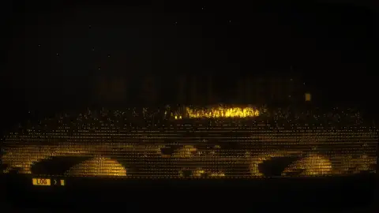

# 13 · ASCII Character Visuals · ASCII字符视觉

[All styles](README.md) · [← Chinese Ink Wash](chinese-ink-wash.md) · [Isometric 2.5D World →](isometric-world.md)



<sub>Preview: layer A by LemoLab · lemo-opuscar, CC BY 4.0. 预览是 LemoLab · lemo-opuscar 的 A，CC BY 4.0。</sub>

**Status 状态:** Upstream implementation, link only · 上游实做，只给链接

## Prompt (copy this)

Paste into Claude, GPT or any coding model. Swap *your topic* for your own subject.

```text
Build your topic from a monospace character grid on an amber monochrome CRT phosphor screen, with scanlines and glow, and do the camera push and pull by changing the font size. Key visuals: monospace character grid, amber or green phosphor monochrome, CRT scanlines and barrel distortion, bloom glow, character density gradient, blinking cursor, push and pull by changing font size, typewriter subtitles. Watch out: Every bright spot must be a real character in the grid; applying an ASCII filter to the whole image gives it away. Output 1920×1080, 30 fps, 8 seconds, as reproducible source code rendered to MP4.
```

## 提示语（复制这段）

发给 Opus 5.5 或任意能写代码的模型，把你的主题换成自己的内容。

```text
用等宽字符网格拼出你的主题，琥珀色单色 CRT 荧光屏，加扫描线和辉光，推拉镜头靠改字号来做。画面要点：monospace 字符网格、琥珀或绿色荧光单色、CRT 扫描线与桶形畸变、bloom 辉光、字符密度梯度、光标闪烁、改字号推拉、打字机字幕。注意：每一处亮点都得是网格里的真字符，整图套 ASCII 滤镜会露馅。输出 1920×1080、30fps、8 秒，写成可复现的源码并渲染成 MP4。
```

## What the two examples show · 两个示例

| | English | 中文 |
|---|---|---|
| A | Warm yellow characters form a city night scene on black, and a character-built globe slowly rises. | 黑底上暖黄字符拼出城市夜景，一颗字符地球慢慢升起。 |
| B | A side-profile head and fingerprint ripples made of green characters. | 绿色字符组成的人头侧影和指纹涟漪。 |

## Where it usually breaks · 容易失败的点

Applying an ASCII filter to the whole image looks like a filter at a glance; every pixel must come from a real character in the grid; too small a character set blurs the image.

整张图套 ASCII 滤镜一看就是滤镜；每个像素都要来自网格里的真字符；字符集太少画面会糊。

## Key visuals · 画面要点

monospace character grid, amber or green phosphor monochrome, CRT scanlines and barrel distortion, bloom glow, character density gradient, blinking cursor, push and pull by changing font size, typewriter subtitles

monospace 字符网格、琥珀或绿色荧光单色、CRT 扫描线与桶形畸变、bloom 辉光、字符密度梯度、光标闪烁、改字号推拉、打字机字幕

Palette 主色：`#151515`

## References · 参考来源

| Layer | Title | Source | License |
|---|---|---|---|
| A | 终端字符组成故乡与地球 | [LemoLab · lemo-opuscar](https://github.com/lemomo-ai/lemo-opuscar/tree/main/styles/ascii-crt) | prompts/code MIT, demo video CC BY 4.0 |
| B | ASCII字符音乐视觉 | [prompt-motion.com](https://prompt-motion.com/rames-jusso-589f80) | link only |

## Reproduce · 复现

No source in this repo yet. The prompt above is enough to build it from scratch.

本仓库暂时没有这个画风的源码，直接用上面的提示语就能从零做出来。
