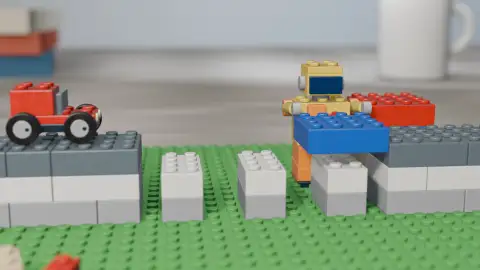

# 27 · Brick Toy · 积木玩具

[All styles](README.md) · [← Glassmorphism UI](glassmorphism-ui.md) · [Risograph Print →](risograph.md)



<sub>Preview: our render (layer B), MIT. 预览是我们渲染的 B，MIT 许可。</sub>

## Prompt (copy this)

Paste into Claude, GPT or any coding model. Swap *your topic* for your own subject.

```text
Use Blender to make a toy-brick stop-motion of your topic, macro-shot on a real wooden table, glossy plastic with studs, characters posed on twos, with a smooth camera. Key visuals: real tabletop, macro shallow depth of field, glossy ABS rectangular highlights, studs on top faces, contact shadows in the seams, characters stop-motion on twos, camera smooth frame by frame, neutral studio HDRI. Watch out: No brand names or minifigure silhouettes; build the characters out of bricks. Output 1920×1080, 30 fps, 8 seconds, as reproducible source code rendered to MP4.
```

## 提示语（复制这段）

发给 Opus 5.5 或任意能写代码的模型，把你的主题换成自己的内容。

```text
用 Blender 做你的主题的积木定格，真实木桌上微距拍，亮面塑料带凸点，角色两帧一拍定格，镜头保持顺滑。画面要点：真实桌面、微距浅景深、亮面 ABS 矩形高光、顶面凸点、缝隙接触阴影、角色 on twos 定格、镜头逐帧顺滑、中性棚拍 HDRI。注意：别出现品牌字样和小人轮廓，角色用积木拼出来。输出 1920×1080、30fps、8 秒，写成可复现的源码并渲染成 MP4。
```

## What the two examples show · 两个示例

| | English | 中文 |
|---|---|---|
| A | A brick robot knocks over a red and white brick tower, with a teapot in the background, shot like a real tabletop. | 积木机器人推倒红白积木塔，背景是茶壶，桌面实拍感。 |
| B | Our render: a brick car drives over a brick bridge while a little figure stacks bricks beside it. | 我们做的制作。积木小车开过一座积木桥，小人在旁边搭砖。 |

## Where it usually breaks · 容易失败的点

Using branded minifigures carries copyright risk; bricks need studs and plastic highlights; deep depth of field no longer looks like a real macro shot.

用品牌小人会有版权风险；积木要有凸点和塑料高光；景深一深就不像微距实拍。

## Key visuals · 画面要点

real tabletop, macro shallow depth of field, glossy ABS rectangular highlights, studs on top faces, contact shadows in the seams, characters stop-motion on twos, camera smooth frame by frame, neutral studio HDRI

真实桌面、微距浅景深、亮面 ABS 矩形高光、顶面凸点、缝隙接触阴影、角色 on twos 定格、镜头逐帧顺滑、中性棚拍 HDRI

Palette 主色：`#4eb83e` `#b86c3e`

## References · 参考来源

| Layer | Title | Source | License |
|---|---|---|---|
| A | 积木玩具：Rocket from Spare Parts | [LemoLab · lemo-opuscar](https://github.com/lemomo-ai/lemo-opuscar/tree/main/styles/brick-toy) | prompts/code MIT, demo video CC BY 4.0 |
| B | carl-motion | [this repo](../../templates/scenes/brick-toy) | MIT |

## Reproduce · 复现

Source that rendered the B clip: [`templates/scenes/brick-toy`](../../templates/scenes/brick-toy) (Blender + Python). Its README has the exact render command.

渲染 B 的完整源码在 [`templates/scenes/brick-toy`](../../templates/scenes/brick-toy)（Blender + Python），渲染命令写在它的 README 里。
