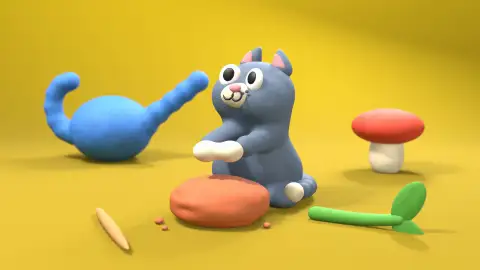

# 17 · Claymation Stop-motion · 黏土定格

[All styles](README.md) · [← Iridescent Psychedelic Shader](psychedelic-shader.md) · [Pixel Game →](pixel-game.md)



<sub>Preview: our render (layer B), MIT. 预览是我们渲染的 B，MIT 许可。</sub>

**Status 状态:** Implemented, one scene · 单场景实做

## Prompt (copy this)

Paste into Claude, GPT or any coding model. Swap *your topic* for your own subject.

```text
Use Blender to make a clay stop-motion animation of your topic, with fingerprints and dents on the surface, a pose change every two frames played at 12 fps, and soft studio lighting with shallow depth of field. Key visuals: clay material with fingerprints and dents, on twos 12fps, slight shape change boil on every beat, soft studio light, shallow-depth macro, handmade jump-cut rhythm. Watch out: Smooth motion looks like CG; drop frames on purpose and change the shape slightly on every beat. Output 1920×1080, 30 fps, 8 seconds, as reproducible source code rendered to MP4.
```

## 提示语（复制这段）

发给 Opus 5.5 或任意能写代码的模型，把你的主题换成自己的内容。

```text
用 Blender 做你的主题的黏土定格动画，表面留指纹和压痕，两帧换一个姿势按 12 帧播放，柔光棚拍浅景深。画面要点：黏土材质指纹压痕、on twos 12fps、每拍形状微变 boil、柔光棚拍、浅景深微距、手工跳切节奏。注意：动作一顺滑就像 CG，要故意抽帧，形状每一拍都微微变。输出 1920×1080、30fps、8 秒，写成可复现的源码并渲染成 MP4。
```

## What the two examples show · 两个示例

| | English | 中文 |
|---|---|---|
| A | On a yellow background a clay old man and a row of clay objects (avocado, toast, headphones) dance, with blue clay splatters flying. | 黄底上黏土老头和一排黏土小物（牛油果、吐司、耳机）跳舞，蓝色泥点飞溅。 |
| B | Our render: a blue clay cat kneads a lump of clay, pinches out a flower pot and plants a sprout. | 我们做的制作。黏土蓝猫揉泥团、捏出花盆、种下一棵芽。 |

## Where it usually breaks · 容易失败的点

Motion that is too smooth looks like 3D animation; drop frames to get a stop-motion feel; a material without fingerprints and dents is just plastic; the light should look like a real tabletop shoot.

动作太顺就像 3D 动画，要抽帧做出定格感；材质没有指纹和压痕就是塑料；光要像桌面实拍。

## Key visuals · 画面要点

clay material with fingerprints and dents, on twos 12fps, slight shape change boil on every beat, soft studio light, shallow-depth macro, handmade jump-cut rhythm

黏土材质指纹压痕、on twos 12fps、每拍形状微变 boil、柔光棚拍、浅景深微距、手工跳切节奏

Palette 主色：`#b8a83e`

## References · 参考来源

| Layer | Title | Source | License |
|---|---|---|---|
| A | 黏土设备乐队MV | [prompt-motion.com](https://prompt-motion.com/davidshulmanfl-371638) | link only |
| B | carl-motion | [this repo](../../skills/carl-motion/scenes/claymation) | MIT |

## Reproduce · 复现

Source that rendered the B clip: [`skills/carl-motion/scenes/claymation`](../../skills/carl-motion/scenes/claymation) (Blender + Python). Check dependencies first with `python3 skills/carl-motion/scripts/doctor.py claymation`.

```bash
cd skills/carl-motion/scenes/claymation
./render.sh /tmp/claymation
python3 ../../scripts/deliver.py --frames /tmp/claymation/frames --out claymation.mp4
```

渲染 B 的完整源码在 [`skills/carl-motion/scenes/claymation`](../../skills/carl-motion/scenes/claymation)（Blender + Python），渲染命令写在它的 README 里。
