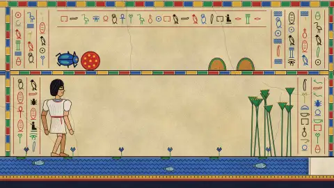

# 23 · Ancient Egyptian Mural · 古埃及壁画

[All styles](README.md) · [← White-model Projection](white-model-projection.md) · [Product Exploded View →](exploded-view.md)



<sub>Preview: our render (layer B), MIT. 预览是我们渲染的 B，MIT 许可。</sub>

## Prompt (copy this)

Paste into Claude, GPT or any coding model. Swap *your topic* for your own subject.

```text
Use Canvas 2D to paint your topic as an ancient Egyptian tomb mural: figures with profile faces and frontal eyes, register bands composed with hieroglyph columns, flat ochre and lapis fills with black outlines. Key visuals: profile-face frontal-eye convention, column-divided horizontal registers, hieroglyph columns, flat fills of ochre, lapis, peacock green and earth yellow, black outlines, small hands at the ends of sun rays, lime plaster wall texture. Watch out: A mural is flat, so add no perspective or shadows, and animate the river and light so it is not too static. Output 1920×1080, 30 fps, 8 seconds, as reproducible source code rendered to MP4.
```

## 提示语（复制这段）

发给 Opus 5.5 或任意能写代码的模型，把你的主题换成自己的内容。

```text
用 Canvas 2D 把你的主题画成古埃及墓室壁画，人物侧脸正眼，分栏横带构图配象形文字栏，赭石青金平涂加黑描边。画面要点：侧脸正眼程式、分栏横带 register、象形文字栏、赭石青金孔雀绿土黄平涂、黑色描边、太阳光线末端小手、墙面石灰质感。注意：壁画是平的，别加透视和阴影，再让河水和光线动起来免得太静。输出 1920×1080、30fps、8 秒，写成可复现的源码并渲染成 MP4。
```

## What the two examples show · 两个示例

| | English | 中文 |
|---|---|---|
| A | A girl and a cat painted as an Egyptian mural, torsos frontal and heads in profile, with a hieroglyph border. | 少女与猫画成埃及壁画，正身侧脸，象形文字边框。 |
| B | Our render: Carl walks through the mural panels, with papyrus and a sun disk beside him. | 我们做的制作。卡尔走过壁画格子，旁边纸莎草和太阳圆盘。 |

## Where it usually breaks · 容易失败的点

Adding perspective and shadows no longer looks like a mural; figures must use the canonical pose with frontal torso and profile head; use only mineral colors such as ochre red, earth yellow and blue-green.

加透视和阴影就不像壁画；人物要正身侧脸的规范姿势；颜色只用赭红、土黄、青绿这类矿物色。

## Key visuals · 画面要点

profile-face frontal-eye convention, column-divided horizontal registers, hieroglyph columns, flat fills of ochre, lapis, peacock green and earth yellow, black outlines, small hands at the ends of sun rays, lime plaster wall texture

侧脸正眼程式、分栏横带 register、象形文字栏、赭石青金孔雀绿土黄平涂、黑色描边、太阳光线末端小手、墙面石灰质感

Palette 主色：`#b88a3e`

## References · 参考来源

| Layer | Title | Source | License |
|---|---|---|---|
| A | 少女与猫喝茶 · 古埃及壁画 | [alchaincyf · huashu-art-motion](https://github.com/alchaincyf/huashu-art-motion) | MIT (re-rendered from source) |
| B | carl-motion | [this repo](../../templates/scenes/huashu-portraits) | MIT |

## Reproduce · 复现

Source that rendered the B clip: [`templates/scenes/huashu-portraits`](../../templates/scenes/huashu-portraits) (Canvas / HTML + Node). Its README has the exact render command.

渲染 B 的完整源码在 [`templates/scenes/huashu-portraits`](../../templates/scenes/huashu-portraits)（Canvas / HTML + Node），渲染命令写在它的 README 里。
