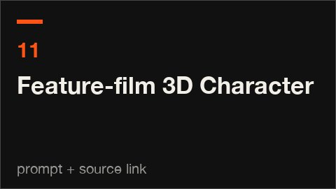

# 11 · Feature-film 3D Character · 动画电影式3D角色

[All styles](README.md) · [← Die-cut Sticker Explainer](sticker-explainer.md) · [Chinese Ink Wash →](chinese-ink-wash.md)



<sub>No redistributable clip. Watch it at the source link. 没有可随仓库分发的片段，去来源链接看。</sub>

**Status 状态:** Research recipe, prompt only · 研究配方，只有提示语

## Prompt (copy this)

Paste into Claude, GPT or any coding model. Swap *your topic* for your own subject.

```text
Use the best technology you can think of to make an animated short, with your topic as the protagonist: cinematic lighting, shallow depth of field, a character with expression and performance, as complex and refined as you can make it. Key visuals: one-shot animated short, tech stack of your choice, cinematic backlight and sunset, shallow depth of field, character expression and performance, a small story told shot by shot, cinematic subtitle bar. Watch out: Just saying make a character falls back to a crude stick figure; explicitly ask for the most complex and refined result. Output 1920×1080, 30 fps, 8 seconds, as reproducible source code rendered to MP4.
```

## 提示语（复制这段）

发给 Opus 5.5 或任意能写代码的模型，把你的主题换成自己的内容。

```text
用你认为最好的技术做一支动画短片，主角是你的主题，电影布光、浅景深、角色有表情有表演，做到你能做到的最复杂最精致。画面要点：one-shot 动画短片、自选技术栈、电影级逆光与夕阳、浅景深、角色表情与表演、按镜头讲小故事、电影字幕条。注意：只说做个角色会退成简陋小人，要明确要求最复杂最精致。输出 1920×1080、30fps、8 秒，写成可复现的源码并渲染成 MP4。
```

## What the two examples show · 两个示例

| | English | 中文 |
|---|---|---|
| A | A pelican rides a bicycle past a sunset pier, with cinematic shallow depth of field and warm backlight. | 鹈鹕骑自行车经过夕阳码头，电影感浅景深和暖色逆光。 |
| B | A small robot and a retro radio in a lighthouse, an oscilloscope screen lights up, with English subtitles. | 灯塔里的小机器人和复古收音机，示波器屏幕亮起，英文字幕。 |

## Where it usually breaks · 容易失败的点

Just saying make a character falls back to a crude SVG figure; state that it should be made as complex as possible and open up Three.js or Blender; without depth of field and rim light it does not look like an animated film.

只说做个角色会退成简陋的 SVG 小人；要写明往最复杂了做，放开 Three.js 或 Blender；没有景深和轮廓光就不像动画电影。

## Key visuals · 画面要点

one-shot animated short, tech stack of your choice, cinematic backlight and sunset, shallow depth of field, character expression and performance, a small story told shot by shot, cinematic subtitle bar

one-shot 动画短片、自选技术栈、电影级逆光与夕阳、浅景深、角色表情与表演、按镜头讲小故事、电影字幕条

Palette 主色：`#b86c3e`

## References · 参考来源

| Layer | Title | Source | License |
|---|---|---|---|
| A | 鹈鹕骑自行车 | [prompt-motion.com](https://prompt-motion.com/axtonliu-0b861d) | link only |
| B | 机器人守灯塔 | [prompt-motion.com](https://prompt-motion.com/faroukzy-9ff23e) | link only |

## Reproduce · 复现

No source in this repo yet. The prompt above is enough to build it from scratch.

本仓库暂时没有这个画风的源码，直接用上面的提示语就能从零做出来。
