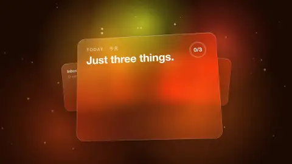

# 26 · Glassmorphism UI · 玻璃拟态UI

[All styles](README.md) · [← Editorial Paper Data Story](editorial-dataviz.md) · [Brick Toy →](brick-toy.md)



<sub>Preview: our render (layer B), MIT. 预览是我们渲染的 B，MIT 许可。</sub>

## Prompt (copy this)

Paste into Claude, GPT or any coding model. Swap *your topic* for your own subject.

```text
Use HTML to make a glassmorphism animation of your topic: three to five large Gaussian-blurred color blobs drift slowly underneath, with frosted glass cards floating on top, with a 1px translucent white border. Key visuals: aurora color blobs with blur 80 to 150px, backdrop-filter frosted cards, white fill at 5 to 10%, 1px white border, two or three adjacent hues, 3 to 5% noise to prevent banding, sine breathing easing. Watch out: Clashing colors get muddy and fast motion looks cheap; keep a slow breathing pace throughout. Output 1920×1080, 30 fps, 8 seconds, as reproducible source code rendered to MP4.
```

## 提示语（复制这段）

发给 Opus 5.5 或任意能写代码的模型，把你的主题换成自己的内容。

```text
用 HTML 做你的主题的玻璃拟态动画，底层三到五个大色斑高斯模糊慢慢漂，上面浮磨砂玻璃卡片，1px 半透明白描边。画面要点：aurora 大色斑 blur 80 到 150px、backdrop-filter 磨砂卡片、白色 5 到 10% 填充、1px 白描边、邻近色两三色、3 到 5% 噪点防色带、sine 呼吸缓动。注意：撞色会脏，动作一快就廉价，全程慢呼吸。输出 1920×1080、30fps、8 秒，写成可复现的源码并渲染成 MP4。
```

## What the two examples show · 两个示例

| | English | 中文 |
|---|---|---|
| A | Frosted glass cards drift over deep blue-purple light blobs, switches and sliders move, and an Aurora wordmark closes it out. | 深蓝紫光斑上漂着磨砂玻璃卡片，开关和滑块在动，最后 Aurora 字标。 |
| B | Our render: A to-do glass card over warm amber-orange light blobs, items checked off one by one, and a Focus orb lights up. | 我们做的。琥珀橙暖色光斑上的待办玻璃卡，逐条勾选，Focus 球亮起。 |

## Where it usually breaks · 容易失败的点

Contrasting colors look cheap, so use only adjacent hues; keep motion slow; glass without a 1px translucent white edge and background blur looks like an ordinary card.

用对比色会显廉价，只用邻近色；动作要慢；玻璃缺 1px 半透明白边和背景模糊就像普通卡片。

## Key visuals · 画面要点

aurora color blobs with blur 80 to 150px, backdrop-filter frosted cards, white fill at 5 to 10%, 1px white border, two or three adjacent hues, 3 to 5% noise to prevent banding, sine breathing easing

aurora 大色斑 blur 80 到 150px、backdrop-filter 磨砂卡片、白色 5 到 10% 填充、1px 白描边、邻近色两三色、3 到 5% 噪点防色带、sine 呼吸缓动

Palette 主色：`#3e4eb8`

## References · 参考来源

| Layer | Title | Source | License |
|---|---|---|---|
| A | 聊天卡片与Focus玻璃开关 | [Vincentwei1021 · mg-styles-15](https://vincentwei1021.github.io/mg-styles-15/?lang=zh#12-aurora-glass) | prompts/code MIT; demo video not redistributed |
| B | carl-motion | [this repo](../../templates/scenes/glassmorphism-ui) | MIT |

## Reproduce · 复现

Source that rendered the B clip: [`templates/scenes/glassmorphism-ui`](../../templates/scenes/glassmorphism-ui) (Three.js + Node). Its README has the exact render command.

渲染 B 的完整源码在 [`templates/scenes/glassmorphism-ui`](../../templates/scenes/glassmorphism-ui)（Three.js + Node），渲染命令写在它的 README 里。
