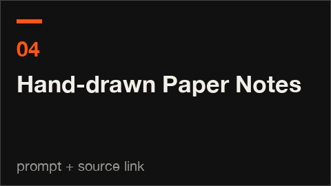

# 04 · Hand-drawn Paper Notes · 纸面手绘笔记

[All styles](README.md) · [← Neon Synthwave](neon-synthwave.md) · [Watercolor →](watercolor.md)



<sub>No redistributable clip. Watch it at the source link. 没有可随仓库分发的片段，去来源链接看。</sub>

**Status 状态:** Research recipe, prompt only · 研究配方，只有提示语

## Prompt (copy this)

Paste into Claude, GPT or any coding model. Swap *your topic* for your own subject.

```text
Use HTML to make a step-by-step animation of your topic on off-white paper: hand-drawn thin lines draw the equipment, and each time something is added, its name and amount pop up in sync. Key visuals: off-white paper, hand-drawn thin-line equipment, handwritten titles and amounts, numbered step cards, from empty to finished, tick marks, explainer pacing. Watch out: If text and action are out of sync there is no explainer feel; every step appears on the same beat. Output 1920×1080, 30 fps, 8 seconds, as reproducible source code rendered to MP4.
```

## 提示语（复制这段）

发给 Opus 5.5 或任意能写代码的模型，把你的主题换成自己的内容。

```text
用 HTML 在米白纸面上做你的主题的步骤动画，手绘细线画器物，每加一样东西就同步跳出名称和用量。画面要点：米白纸面、手绘细线器物、手写体标题与用量、步骤编号卡、从空到成品、刻度线、讲解节奏。注意：字和动作不同步就没有讲解感，每一步同一拍出现。输出 1920×1080、30fps、8 秒，写成可复现的源码并渲染成 MP4。
```

## What the two examples show · 两个示例

| | English | 中文 |
|---|---|---|
| A | A hand-drawn bottle on off-white paper pours gin into a glass, and a card on the right pops up 1 oz GIN with a tick-mark bar in sync. | 米白纸上的手绘酒瓶往杯里倒金酒，右侧卡片同步跳出 1 oz GIN 和刻度条。 |
| B | A cocktail step diagram: the handwritten label Pour the vodka and the amount number rise together with the liquid level. | 调酒步骤图，Pour the vodka 的手写标注和用量数字跟着液面一起涨。 |

## Where it usually breaks · 容易失败的点

If the label and the pouring action are not on the same beat there is no explainer feel; lines that are too regular look like an icon library; too many colors kill the hand-drawn feel.

标签和倒酒动作不在同一拍就没有讲解感；线条太规整会像图标库；颜色一多就压掉手绘感。

## Key visuals · 画面要点

off-white paper, hand-drawn thin-line equipment, handwritten titles and amounts, numbered step cards, from empty to finished, tick marks, explainer pacing

米白纸面、手绘细线器物、手写体标题与用量、步骤编号卡、从空到成品、刻度线、讲解节奏

Palette 主色：`#ededed`

## References · 参考来源

| Layer | Title | Source | License |
|---|---|---|---|
| A | Negroni手绘酒方 | [prompt-motion.com](https://prompt-motion.com/ror-fly-9950f1) | link only |
| B | White Russian手绘酒方 | [prompt-motion.com](https://prompt-motion.com/sarut0bisasuke-cefa43) | link only |

## Reproduce · 复现

No source in this repo yet. The prompt above is enough to build it from scratch.

本仓库暂时没有这个画风的源码，直接用上面的提示语就能从零做出来。
