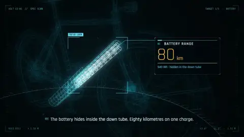

# 29 · Sci-fi Scan HUD · 科幻扫描HUD

[All styles](README.md) · [← Risograph Print](risograph.md) · [Retro Paper Collage →](retro-paper-collage.md)



<sub>Preview: layer A by LemoLab · lemo-opuscar, CC BY 4.0. 预览是 LemoLab · lemo-opuscar 的 A，CC BY 4.0。</sub>

## Prompt (copy this)

Paste into Claude, GPT or any coding model. Swap *your topic* for your own subject.

```text
Use Three.js wireframes to scan your topic into a glowing holographic volume: target boxes lock onto parts and then pull them apart, numbers roll from garbled characters to true values, in a single color with glow. Key visuals: glowing wireframe, projection base, scan plane growth, target-lock boxes, local teardown, garbled digits rolling down to settle, one cool color plus one warm accent, near-black stage, bloom. Watch out: Do not put text directly over the wireframe; put it on a dark backing plate, and keep the parts connected. Output 1920×1080, 30 fps, 8 seconds, as reproducible source code rendered to MP4.
```

## 提示语（复制这段）

发给 Opus 5.5 或任意能写代码的模型，把你的主题换成自己的内容。

```text
用 Three.js 线框把你的主题扫描成发光全息体，目标框锁定部件再拆开，数字从乱码滚到真值，单色加辉光。画面要点：发光 wireframe、投影底座、扫描面生长、目标锁定框、局部拆解、乱码数字滚动落定、单冷色加一个暖色强调、近黑舞台、bloom。注意：文字别直接压在线框上，放进暗底板，部件之间要连着。输出 1920×1080、30fps、8 秒，写成可复现的源码并渲染成 MP4。
```

## What the two examples show · 两个示例

| | English | 中文 |
|---|---|---|
| A | A holographic scan of an electric bicycle, battery and motor readouts lighting up one by one on a dark cyan-blue background. | 电动自行车全息扫描，电池、电机读数逐项亮出，暗青蓝底。 |
| B | A cyan globe scanning interface with scrolling readouts, finally turning into an orange target lock. | 青色地球扫描界面，读数滚动，最后转成橙色目标锁定。 |

## Where it usually breaks · 容易失败的点

Text laid directly over a wireframe is hard to read, so put it on a dark backing plate; floating parts look fake, so keep them connected; too many colors get messy.

线框上直接叠字会看不清，字要放暗底板；部件悬空会假，要连在一起；颜色一多就乱。

## Key visuals · 画面要点

glowing wireframe, projection base, scan plane growth, target-lock boxes, local teardown, garbled digits rolling down to settle, one cool color plus one warm accent, near-black stage, bloom

发光 wireframe、投影底座、扫描面生长、目标锁定框、局部拆解、乱码数字滚动落定、单冷色加一个暖色强调、近黑舞台、bloom

Palette 主色：`#3ea8b8`

## References · 参考来源

| Layer | Title | Source | License |
|---|---|---|---|
| A | 线框自行车与部件扫描 | [LemoLab · lemo-opuscar](https://github.com/lemomo-ai/lemo-opuscar/tree/main/styles/hologram-hud) | prompts/code MIT, demo video CC BY 4.0 |
| B | 地球雷达与目标锁定 | [Vincentwei1021 · mg-styles-15](https://vincentwei1021.github.io/mg-styles-15/?lang=zh#22-hud) | prompts/code MIT; demo video not redistributed |

## Reproduce · 复现

No source in this repo yet. The prompt above is enough to build it from scratch.

本仓库暂时没有这个画风的源码，直接用上面的提示语就能从零做出来。
