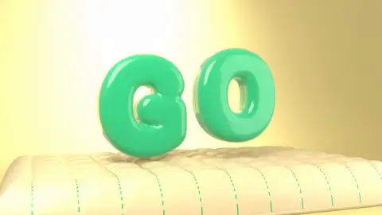

# 07 · Soft Inflatable 3D · 软体充气3D

[All styles](README.md) · [← Black-and-white Woodcut](woodcut.md) · [Point-cloud Survey →](point-cloud-survey.md)



<sub>Preview: our render (layer B), MIT. 预览是我们渲染的 B，MIT 许可。</sub>

## Prompt (copy this)

Paste into Claude, GPT or any coding model. Swap *your topic* for your own subject.

```text
Use Blender to make your topic as soft inflatable 3D: candy-colored soft rubber with subsurface scattering, squashing flat on landing then bouncing back fast, studio three-point lighting, shallow depth of field. Key visuals: SSS soft rubber, candy colors, AO plus HDRI three-point lighting, cloner arrays, soft-body collision squash, long-tail easing, shallow depth of field and motion blur, 24fps cinematic frame rate. Watch out: A slow rebound has no weight: accelerate on the fall, squash on contact, and bounce back fast. Output 1920×1080, 30 fps, 8 seconds, as reproducible source code rendered to MP4.
```

## 提示语（复制这段）

发给 Opus 5.5 或任意能写代码的模型，把你的主题换成自己的内容。

```text
用 Blender 做你的主题的软体充气 3D，糖果色软胶带次表面散射，落地压扁再快速弹起，棚拍三点光，浅景深。画面要点：SSS 软胶、糖果色、AO 加 HDRI 三点光、克隆阵列、软体碰撞挤压、长尾缓动、浅景深与运动模糊、24fps 电影帧率。注意：回弹一慢就没重量，下落加速、触地压扁、弹起要快。输出 1920×1080、30fps、8 秒，写成可复现的源码并渲染成 MP4。
```

## What the two examples show · 两个示例

| | English | 中文 |
|---|---|---|
| A | Pink soft-rubber letters spelling soft land on a grainy floor, get squashed and bounce back after small balls hit them, and the background shifts to purple. | 粉色软胶 soft 字母落在颗粒地面上，被小球撞得压扁回弹，底色转紫。 |
| B | Our render: Green inflatable GO letters land on a soft cushion, squash and spring back up, under warm yellow studio light. | 我们做的。绿色充气 GO 字母落在软垫上压扁再弹起，暖黄棚拍光。 |

## Where it usually breaks · 容易失败的点

A slow rebound has no weight; a material without subsurface scattering looks like hard plastic; flat lighting looks like a web illustration.

回弹一慢就没重量；材质缺次表面散射会像硬塑料；光打平了就像网页插图。

## Key visuals · 画面要点

SSS soft rubber, candy colors, AO plus HDRI three-point lighting, cloner arrays, soft-body collision squash, long-tail easing, shallow depth of field and motion blur, 24fps cinematic frame rate

SSS 软胶、糖果色、AO 加 HDRI 三点光、克隆阵列、软体碰撞挤压、长尾缓动、浅景深与运动模糊、24fps 电影帧率

Palette 主色：`#b83e6c` `#b86c3e`

## References · 参考来源

| Layer | Title | Source | License |
|---|---|---|---|
| A | 3D 渲染：soft.「柔软着陆」 | [Vincentwei1021 · mg-styles-15](https://vincentwei1021.github.io/mg-styles-15/?lang=zh#04-3d-render) | prompts/code MIT; demo video not redistributed |
| B | carl-motion | [this repo](../../templates/scenes/soft-inflatable-3d) | MIT |

## Reproduce · 复现

Source that rendered the B clip: [`templates/scenes/soft-inflatable-3d`](../../templates/scenes/soft-inflatable-3d) (Blender + Python). Its README has the exact render command.

渲染 B 的完整源码在 [`templates/scenes/soft-inflatable-3d`](../../templates/scenes/soft-inflatable-3d)（Blender + Python），渲染命令写在它的 README 里。
